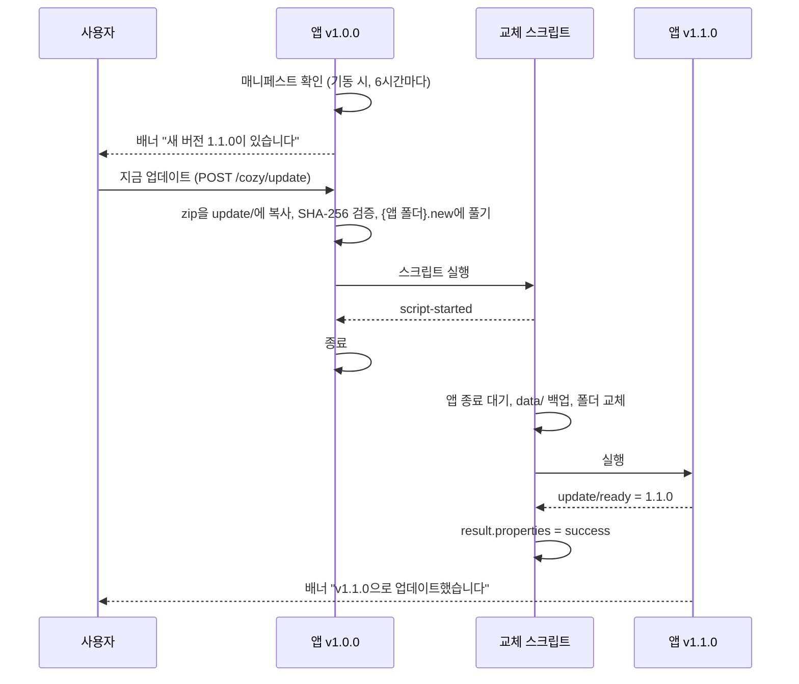

# 배포와 자체 업데이트

앱을 사용자 PC용 실행 폴더로 만들고(PRD §9.6), 공유 폴더나 내부 서버에 올린 새 버전으로 스스로 업데이트한다(PRD §9.4).

## 패키징: `mvn -Pdist package`

앱 폴더에서 실행한다. 빌드 PC에는 JDK 25가 필요하고, 사용자 PC에는 JDK가 필요 없다.

```bash
mvn -Pdist package                                    # 테스트 포함
mvn -Pdist package -Dcozy.dist.notes="검색 속도 개선" -Dcozy.dist.minimum-version=1.0.0
```

결과는 `target/dist/`에 생긴다.

| 경로 | 내용 |
| --- | --- |
| `image/{appId}/` | 실행 폴더(jpackage app-image). Windows는 `{appId}.exe`, 런타임, 앱 jar, AOT 캐시, `licenses/`(제3자 라이선스 목록) |
| `{appId}-{version}-{platform}.zip` | 실행 폴더를 담은 zip. 최상위 폴더는 `{appId}/`. platform은 `win-x64`, `linux-x64` 등 |
| `{appId}-update.json` | 업데이트 매니페스트(zip의 SHA-256 포함) |
| `training.log` | AOT 캐시 훈련 실행의 로그 |

- `cozy.app.id`는 앱의 `application.yml`에서 읽는다. 실행 파일과 폴더 이름이 된다.
- `--app-version`은 버전의 숫자 부분이다(`1.1.0-SNAPSHOT → 1.1.0`). Windows 실행 파일의 버전 정보에 들어간다.
- 프레임워크 레포에서는 앱만 골라서 실행한다: `mvn -Pdist package -pl samples/reference-app`. 앱이 아닌 모듈에서는 enforcer가 막는다.

### 단계

1. **jar 풀기**: Boot jar를 `-Djarmode=tools extract`로 풀어 일반 클래스패스 jar로 만든다. AOT 캐시는 풀린 jar에서만 효과가 있다.
2. **app-image 만들기**: `jpackage --type app-image`. WiX는 필요 없다. JVM 옵션은 `-Xmx512m`과 `--enable-native-access=ALL-UNNAMED`(sqlite-jdbc 네이티브 라이브러리)다.
3. **SQLite 네이티브 라이브러리**: 앱에 sqlite-jdbc가 있으면 플랫폼에 맞는 네이티브 라이브러리(`sqlitejdbc.dll` 등)를 실행 폴더의 앱 폴더(Windows `app\native\`, Linux `lib/app/native/`)에 꺼내 둔다. 실행 옵션에 `-Dorg.sqlite.lib.path=$APPDIR/native`와 `-Dorg.sqlite.lib.name`을 넣는다.
   - 기본 동작은 실행할 때마다 `%TEMP%`에 DLL을 풀어 읽는 것이다. AppLocker 같은 정책이 임시 폴더의 DLL을 막는 PC에서는 이 동작이 실패한다.
   - 앱 폴더에 둔 DLL은 실행 파일과 같은 정책을 받는다.
   - 종단 검증이 파일과 옵션을 확인한다.
4. **제3자 라이선스 목록**: license-maven-plugin이 런타임 의존성의 라이선스 목록을 만든다(`prepare-package`). 패키징이 그 목록을 다시 검사하고, 웹 자산(Tabler, htmx, Pretendard)의 LICENSE, Cozy 자신의 LICENSE·NOTICE(Apache-2.0)와 함께 실행 폴더의 `licenses/`에 담는다.
   - 허용 목록(`cozy.dist.allowed-licenses`)에 없는 라이선스이거나 라이선스 정보가 없는 의존성이 있으면 실패한다.
   - 허용 목록과 이름 맞추기 규칙은 [ADR-0026](../adr/0026-third-party-licenses.md)에 있다.
5. **AOT 캐시 훈련**: 만든 실행 폴더의 런처로 두 번 실행한다.
   - 훈련 실행은 `-XX:AOTMode=record`와 `cozy.runtime.training=true`로 한다. 앱이 기동한 뒤 `/`와 패턴 카탈로그(`/cozy/dev/catalog`)를 한 번씩 요청하고 종료한다.
   - 캐시 생성은 `-XX:AOTMode=create`로 한다.
   - 마지막으로 실행 옵션에 `-XX:AOTCache=$APPDIR/{appId}.aot`를 등록한다.
   - 런타임에 `java` 명령이 없어서(jpackage가 뺀다) JDK 25의 한 단계 방식(`AOTCacheOutput`) 대신 두 단계 방식을 쓴다.
   - 요청이 하나라도 2xx가 아니거나 캐시가 생기지 않으면 패키징이 실패한다.
6. **zip과 매니페스트**: zip을 만든다. Linux 실행 권한을 보존한다. 그다음 SHA-256과 매니페스트를 쓴다.

### 설정 (앱 POM의 `<properties>` 또는 `-D`)

| 속성 | 기본값 | 설명 |
| --- | --- | --- |
| `cozy.dist.notes` | 빈 값 | 매니페스트의 `notes`. 업데이트 배너에 보인다 |
| `cozy.dist.minimum-version` | 빈 값 | 매니페스트의 `minimumVersion`. 이보다 낮은 버전에는 필수 업데이트로 보인다 |
| `cozy.dist.java-options` | `-Xmx512m` | 실행 JVM 옵션(공백으로 구분) |
| `cozy.dist.training` | `true` | AOT 캐시 훈련. 끄면 캐시 없이 만든다 |
| `cozy.dist.allowed-licenses` | `Apache-2.0\|MIT\|BSD-2-Clause\|BSD-3-Clause\|EPL-1.0\|EPL-2.0` | 의존성 허용 라이선스(SPDX ID). 바꾸려면 ADR-0026을 먼저 고친다 |
| `cozy.runtime.training-paths` (앱 `application.yml`) | `/`, `/cozy/dev/catalog` | 훈련 실행에서 요청할 경로. 카탈로그는 cozy-ui가 있을 때만 넣는다 |

### AOT 캐시

reference-app 기준으로 기동 시간이 3.5초에서 1.5초로 줄었다(WSL, 예열 후 5회 중앙값). 측정 방법과 다른 수치는 [performance.md](performance.md)에 있다.

- **캐시가 맞지 않을 때**: 캐시 파일이 망가졌거나 없거나 클래스패스와 맞지 않아도, JVM은 경고만 남기고 캐시 없이 정상 기동한다. 종단 검증이 망가진 캐시로 기동해 이를 확인한다.
- **파일 시각**: 캐시는 jar의 수정 시각을 대조한다.
  - 패키징이 실행 폴더의 시각을 짝수 초로 맞춰 두므로, zip을 풀어도(탐색기 포함) 캐시가 그대로 쓰인다.
  - 다른 도구로 다시 압축하거나 복사해 시각이 바뀌면 캐시 없이 뜬다.
- **캐시를 다시 만드는 경우**: 캐시는 실행 폴더와 함께 배포된다. 업데이트하면 폴더가 통째로 바뀌므로 캐시도 새 버전에 맞는 것으로 바뀐다.

## 설치

사용자가 zip을 쓰기 권한이 있는 위치에 푼다. 기본 위치는 `%LOCALAPPDATA%\Programs\`이고, 결과는 `%LOCALAPPDATA%\Programs\{appId}\{appId}.exe`다.

- **데이터 위치**: 데이터는 `%LOCALAPPDATA%\{appId}\`에 있어 앱 폴더와 분리된다(ADR-0010).
- **쓰기 권한**: `Program Files`처럼 쓰기 권한이 없는 곳에 설치하면 앱은 돌지만 업데이트를 설치할 수 없다. 배너에 이유가 나온다.

## 업데이트 채널

앱의 외부 설정(`{dataDir}/config/application.yml`) 또는 패키지 안 `application.yml`에 둔다.

```yaml
cozy:
  update:
    manifest-url: file://fileserver/share/voc-assistant/voc-assistant-update.json
```

| 속성 | 기본값 | 설명 |
| --- | --- | --- |
| `cozy.update.manifest-url` | 없음(업데이트 꺼짐) | 매니페스트 주소 |
| `cozy.update.check-interval` | `6h` | 확인 주기. 기동할 때 한 번 확인한다 |
| `cozy.update.ready-timeout` | `60s` | 새 버전이 이 시간 안에 준비 신호를 남기지 않으면 되돌린다 |

- **주소 형식**: `file:`(UNC 공유 폴더 포함), `http:`, `https:`를 쓸 수 있다. 경로(`\\fileserver\share\…\x.json`, `C:\…`)를 적으면 `file:` 주소로 바꾼다. 다른 형식이면 기동이 실패한다.
- **패키지 위치**: 패키지는 매니페스트와 같은 폴더에서 읽는다.
- **앱 버전**: 앱 버전은 `META-INF/build-info.properties`(cozy-parent가 켜는 build-info)에서 읽는다. 없으면 업데이트를 확인하지 않는다.
- **확인 실패**: 매니페스트를 읽지 못하면(공유 폴더 연결 끊김 등) 경고 로그만 남기고 이전 상태를 유지한다.

### 매니페스트 (`{appId}-update.json`)

```json
{
  "appId" : "voc-assistant",
  "version" : "1.1.0",
  "minimumVersion" : "1.0.0",
  "package" : "voc-assistant-1.1.0-win-x64.zip",
  "sha256" : "…",
  "releasedAt" : "2026-11-20",
  "notes" : "수정 사항 한 줄"
}
```

- **필수 필드**: `appId`, `version`, `package`, `sha256`이 필수다.
- **appId**: `appId`가 앱과 다르면 무시한다.
- **package**: `package`는 같은 폴더의 `.zip` 파일 이름이어야 한다. 경로나 주소는 받지 않는다.
- **sha256**: `sha256`은 소문자 16진수 64자다.
- **형식 오류**: 형식이 하나라도 틀리면 매니페스트 전체를 거부한다.
- **버전 비교**: 숫자 부분을 차례로 비교한다. 숫자가 같으면 qualifier가 없는 쪽이 높다(`1.1.0-SNAPSHOT < 1.1.0`).

### 배포 절차

1. `mvn -Pdist package`로 만든다.
2. zip을 채널 폴더에 먼저 복사한다.
3. 그다음 매니페스트를 바꾼다. 순서가 바뀌면, 사용자가 매니페스트를 먼저 읽었을 때 아직 없는 zip을 찾게 된다.
4. 이전 zip은 남겨 둬도 된다. 앱은 매니페스트가 가리키는 파일만 읽는다.

## 업데이트 흐름



1. **배너**: 새 버전이 있으면 layout 상단에 배너가 뜬다.
   - 현재 버전이 `minimumVersion`보다 낮으면 빨간색으로 "필수 업데이트"를 함께 보인다. 사용을 막지는 않는다.
2. **설치 준비**: 사용자가 "지금 업데이트"를 누르면 앱이 다음을 차례로 한다.
   1. zip을 `{dataDir}/update/`에 복사하며 SHA-256을 계산한다. 다르면 지우고 멈춘다.
   2. 앱 폴더 옆 `{앱 폴더}.new`에 푼다. 같은 볼륨이어야 이름 바꾸기로 교체할 수 있기 때문이다.
   3. 새 폴더에 같은 실행 파일이 있는지 확인한다.
3. **스크립트 시작**: 앱이 교체 스크립트(Windows `update.ps1`, Linux `update.sh`)를 만들어 실행한다.
   - 스크립트가 `script-started`를 쓰는 것을 확인한 뒤에야 앱이 종료한다.
   - 20초 안에 확인하지 못하면 설치를 취소한다. 이때 `cancelled`를 남긴다. 늦게 뜬 스크립트는 이 파일을 보고 아무것도 하지 않는다.
4. **교체**: 스크립트가 다음을 차례로 한다.
   1. 앱 프로세스가 끝나기를 기다린다(최대 10분).
   2. `{dataDir}/data`를 `update/data-backup`에 복사한다.
   3. 앱 폴더를 `{앱 폴더}.old`로 옮기고, `.new`를 앱 폴더로 옮긴다.
   4. 새 버전을 실행한다.
5. **성공**: 새 버전은 기동을 마치면(Flyway 마이그레이션 포함) `update/ready`에 자기 버전을 쓴다. 스크립트는 이것을 보고 `result.properties`에 성공을 남긴다. 새 버전의 화면에 "v1.1.0으로 업데이트했습니다."가 보인다.
6. **롤백**: `cozy.update.ready-timeout` 안에 준비 신호가 없거나 새 프로세스가 먼저 끝나면 스크립트가 되돌린다.
   1. 새 프로세스를 끝낸다.
   2. 새 폴더를 `{앱 폴더}.failed`로 옮기고, `.old`를 앱 폴더로 되돌린다.
   3. 데이터를 백업으로 바꾼다.
   4. 이전 버전을 실행한다.
   5. 이전 버전의 화면에 "v1.1.1 업데이트를 시작하지 못해 v1.1.0으로 되돌렸습니다."가 보인다.
   6. 실패한 버전은 `update/failed-version`에 남는다. 그 버전은 다시 권하지 않는다. 더 새 버전이 나오면 다시 권한다.

### `{dataDir}/update/`의 파일

| 파일 | 쓰는 쪽 | 내용 |
| --- | --- | --- |
| `update.ps1` / `update.sh` | 앱 | 교체 스크립트. 경로와 버전이 들어 있다 |
| `update-launch.ps1` | 앱 (Windows) | 스크립트를 앱과 분리해 실행하는 보조 스크립트 |
| `update.log` | 스크립트 | 단계별 기록(UTC 시각). 문제가 생기면 먼저 볼 파일 |
| `script-output.log` | 앱 | 스크립트 프로세스의 표준 출력 |
| `script-started`, `cancelled` | 스크립트, 앱 | 시작 확인과 취소 |
| `ready` | 새로 뜬 앱 | 준비 신호(버전) |
| `result.properties` | 스크립트 | 결과. 다음 실행이 읽고 지운다 |
| `failed-version` | 스크립트 | 롤백한 버전 |
| `data-backup/` | 스크립트 | 교체 직전의 `data/`. 다음 업데이트 때 바뀐다 |

### Windows에서

- **스크립트 형식**: 교체 스크립트는 PowerShell(Windows 기본 5.1)이다. UTF-8 BOM으로 써서 한글 경로가 깨지지 않는다.
- **실행 방식**: 앱이 끝나도 스크립트가 함께 끝나지 않도록, 스크립트를 WMI(`Win32_Process.Create`)로 앱 프로세스와 분리해 실행한다. 실패하면 직접 실행한다.
- **실행 정책**: 스크립트는 `-ExecutionPolicy Bypass`로 실행한다.
  - 그룹 정책이 PowerShell 스크립트를 막으면 `script-started`가 생기지 않는다.
  - 이때 앱은 종료하지 않고 "업데이트 스크립트를 실행하지 못했습니다"를 보인다. 앱 폴더는 그대로다.
- **폴더 이동**: 백신 등이 파일을 잡고 있으면 폴더 이동을 0.5초 간격으로 최대 20초 다시 시도한다.

## 종단 검증 (M6 완료 기준)

`samples/dist-e2e`의 `UpdateEndToEndTest`가 실제 app-image로 업데이트와 롤백을 검증한다. jpackage와 훈련 실행으로 몇 분 걸리므로 `e2e` 프로필에서만 돈다.

```bash
mvn -o -Pe2e install                                            # 전체 빌드 + 종단 검증
mvn -o install -DskipTests && mvn -o -Pe2e verify -pl samples/dist-e2e   # 종단 검증만 다시
```

1. reference-app 사본을 세 버전으로 `-Pdist` 패키징한다.
   - 1.0.0
   - 1.1.0: 마이그레이션 추가
   - 1.1.1: 제목에 UNIQUE 인덱스를 거는 마이그레이션. 패키징의 훈련 실행(빈 DB)은 통과하고, 제목이 겹치는 사용자 데이터에서만 실패한다.
   - 처음부터 깨진 마이그레이션은 훈련 실행에서 실패해 패키지 자체가 만들어지지 않는다.
2. 1.0.0 zip을 설치 폴더에 풀고, AOT 캐시를 일부러 망가뜨린 채 실행한다. 메모를 만든다.
3. 채널에 1.1.0을 올리면 배너가 뜬다. 업데이트를 누르면 다음을 확인한다.
   - 1.0.0이 종료된다.
   - 1.1.0이 뜨고 메모가 남아 있다.
   - 진단 파일의 Flyway 이력에 새 마이그레이션이 있다.
4. 1.1.0에서 제목이 같은 메모를 두 개 만들고 1.1.1로 업데이트한다. 1.1.1은 마이그레이션에서 실패하고, 스크립트가 1.1.0으로 되돌린다. 다음을 확인한다.
   - 업데이트 전후에 만든 메모가 모두 남아 있다.
   - 롤백 알림이 보이고, 1.1.1을 다시 권하지 않는다.
5. 화면 메뉴로 종료하면 포트 파일이 지워지고 잠금이 풀린다.

이 검증은 OS에 맞는 스크립트를 쓴다. WSL에서는 bash, Windows에서는 PowerShell이 돈다. Windows 결과는 [windows-verification.md](windows-verification.md)에 기록한다.
